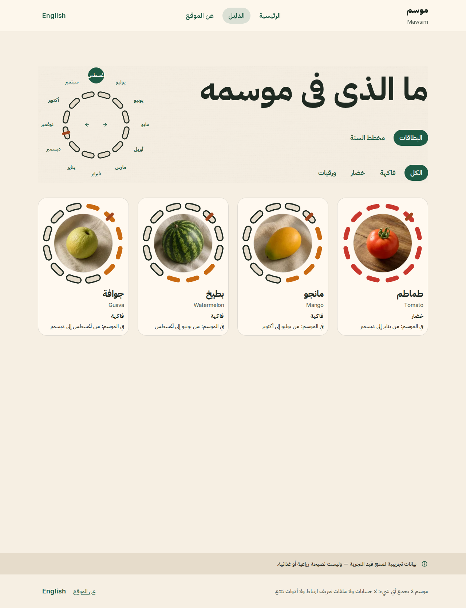
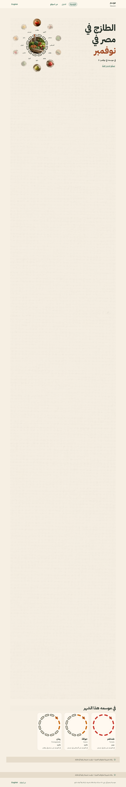
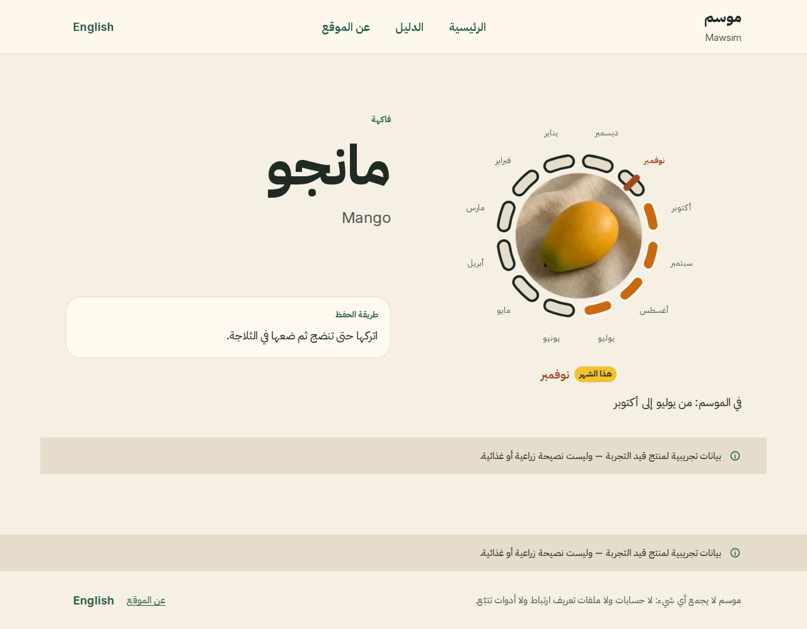
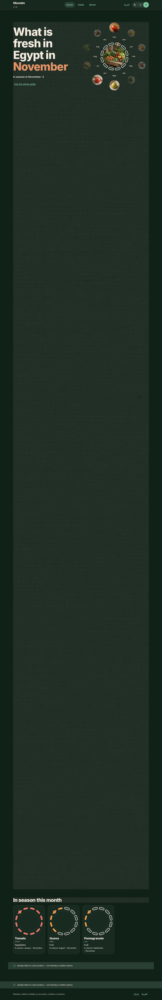

# Mawsim

Mawsim (موسم) is a bilingual guide to which fruits and vegetables are in season in Egypt, month by month, in Arabic and English. Its ten produce rows are sample data, not farming or nutrition advice.

## Features

- [x] The guide's year dial
- [x] The guide's year chart
- [x] The guide's motion: the dial turns and the cards re-sort
- [x] The home page's year story
- [x] The produce page's season arc
- [x] The theme switch: System, Light and Dark, revealed as a circle from the switch

## Screenshots

